# ResumeTailor

An AI-powered resume workstation. Keep one **master resume** in YAML, tailor it to any job description, evaluate your fit, and edit it by chat with an assistant that can actually act on your workspace, not just suggest changes.

---

## Screenshots

Both themes are first-class (light is the default, dark is a full token swap), so a few surfaces are shown in both.

| Onboarding (light) | Onboarding (dark) |
|---|---|
| 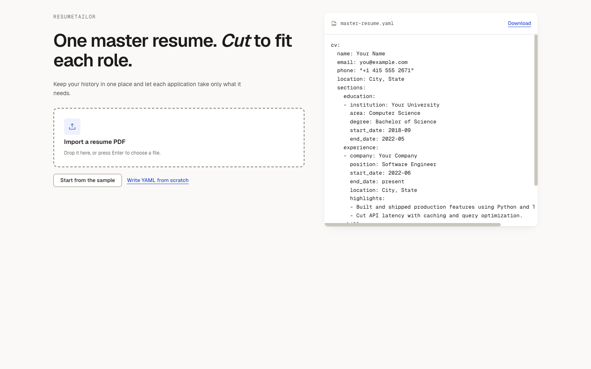 | 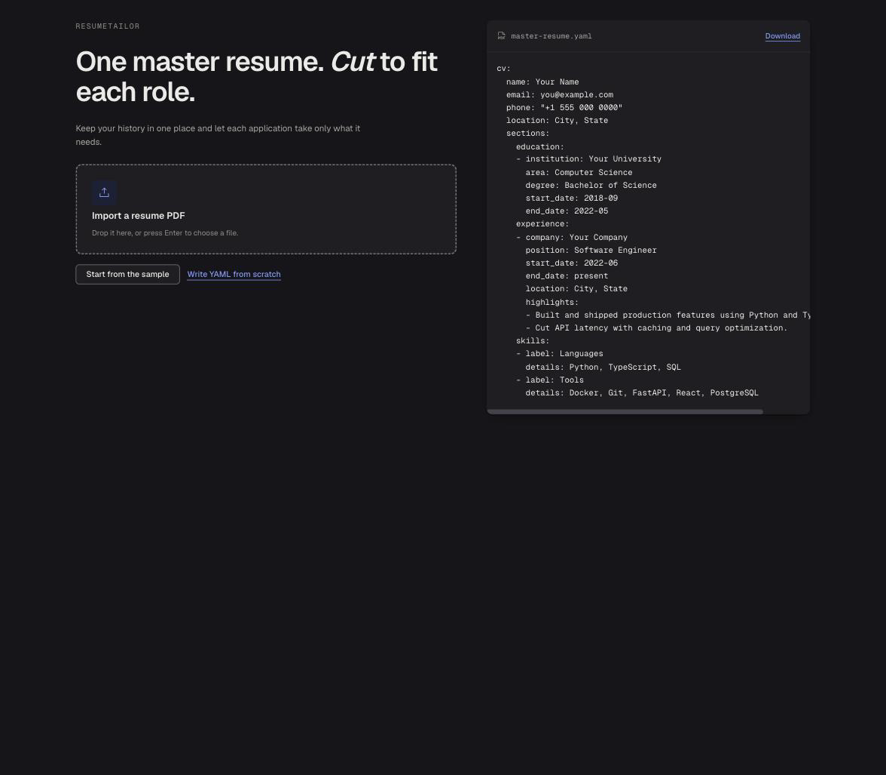 |

| Master document, Editor mode (light) | Master document, Editor mode (dark) |
|---|---|
| 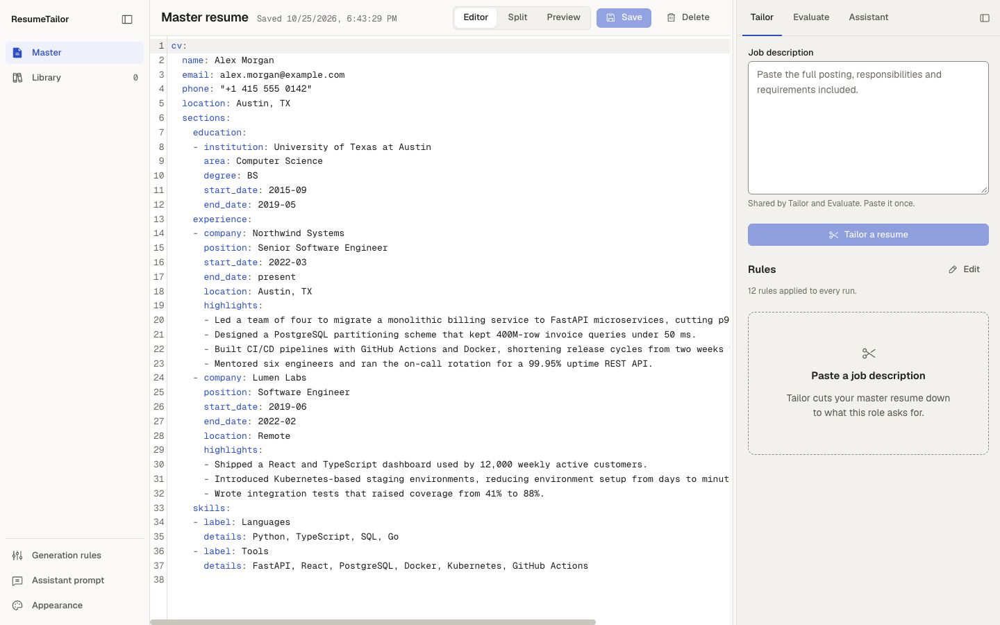 | 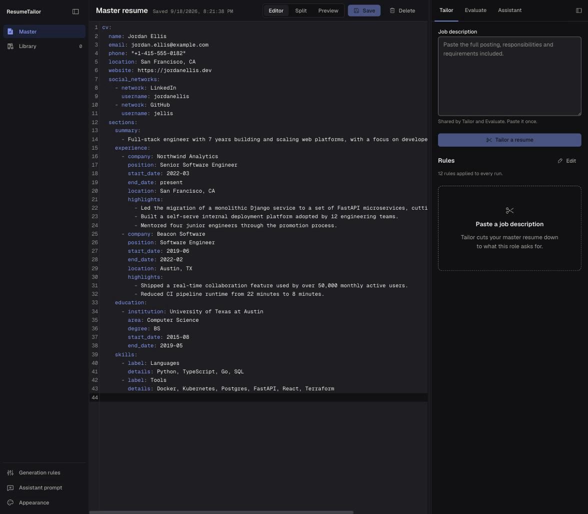 |

| Tailor | Evaluate |
|---|---|
| 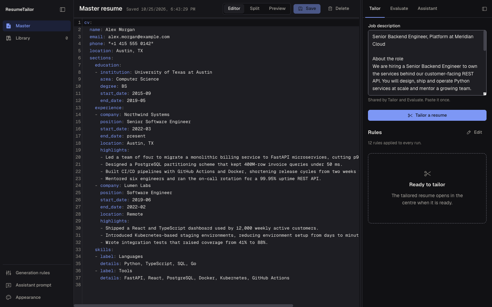 | 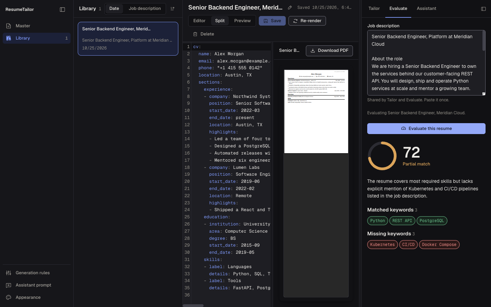 |

| Library, a generated resume open | Library, a generated resume open (light) |
|---|---|
| 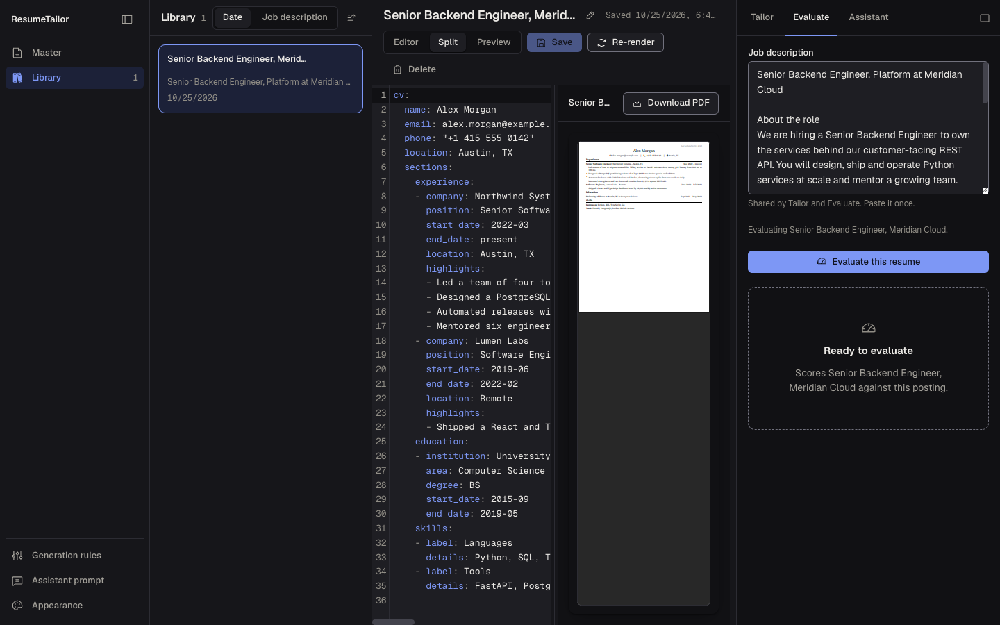 | 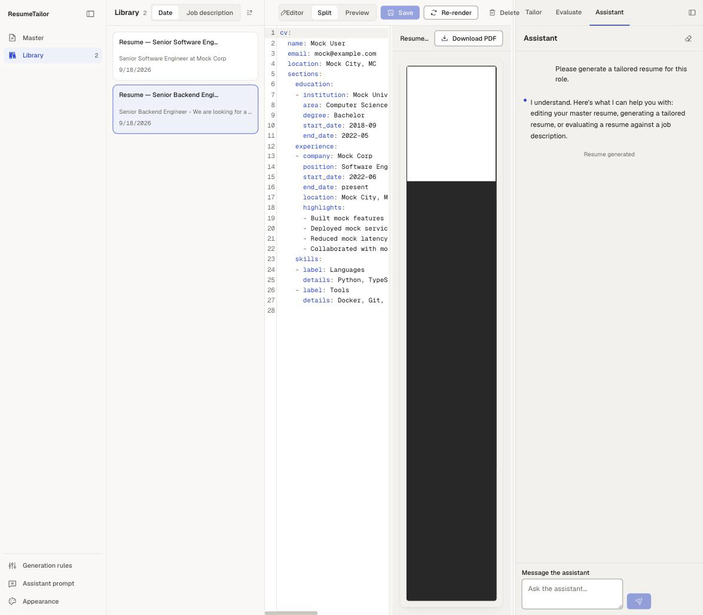 |

| Assistant, a completed tool call | Settings: generation rules |
|---|---|
| 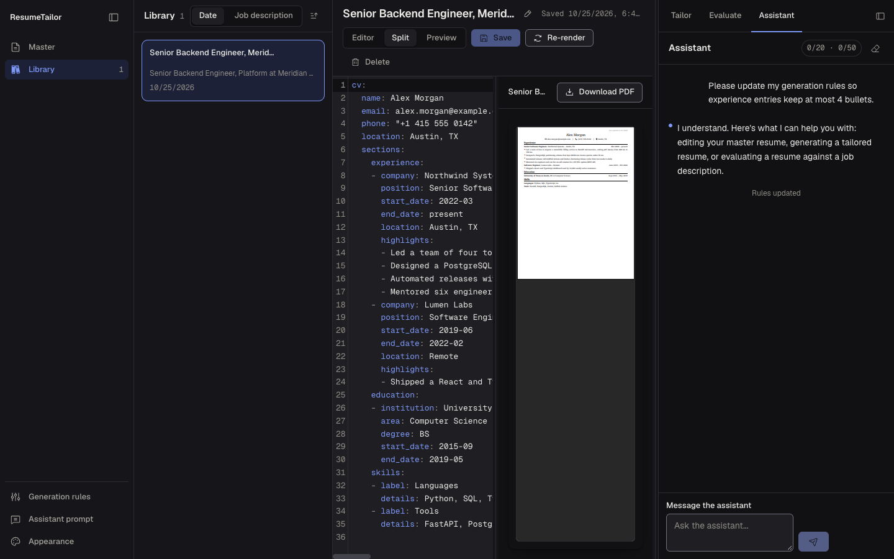 | 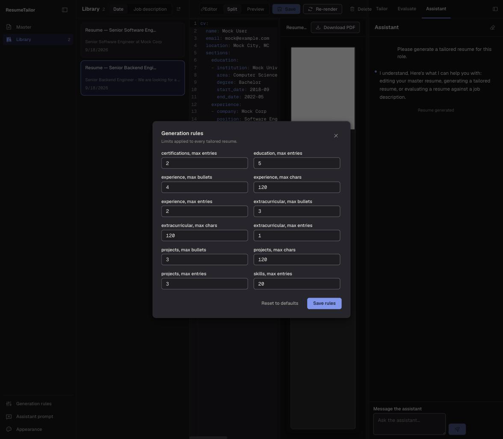 |

| Settings: appearance |
|---|
| 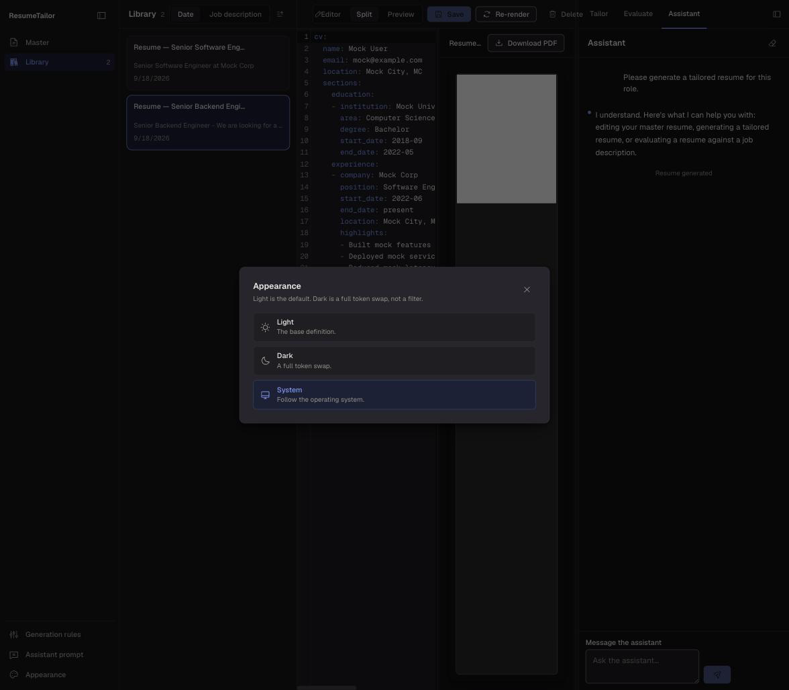 |

---

## Features

**The workspace**
Three zones: a navigation rail (Master, Library, and settings), a center document region, and a right-hand inspector. Whatever document is open, master or generated, uses the same Editor / Split / Preview control, so a generated resume gets exactly the same editing surface as the master.

**Master resume**
Write your complete career history once in [rendercv](https://rendercv.com) YAML, with full syntax highlighting in both themes. The live PDF preview renders alongside the editor. Import an existing PDF and the AI converts it to YAML for you. Edits autosave a local draft and warn before you navigate away with unsaved changes.

**Tailor**
Paste a job description once, in the inspector, shared with Evaluate so you never retype it. Generation streams through three named stages and opens the result as a new document in the center, in the Library, automatically.

**Evaluate**
Score whatever document is currently open, the master's live draft or a generated resume, against the pasted job description: a match score, a plain-English critique, and matched and missing keyword chips.

**Library**
Every generated resume, sortable by date or job description and paged past the first screenful. Open one to rename it, edit its YAML directly, re-render its PDF independently of saving, evaluate it, or delete it.

**Generation rules**
Per-section numeric limits (max bullets, max characters, max entries) applied to every tailoring run, editable from a settings dialog, no prompt-editing required.

**Assistant**
A real chat surface, docked in the inspector so you can watch your document change as it works. It can edit your master resume, generate a tailored resume for a job description, evaluate a resume against one, or update your generation rules, each backed by the same validated write path the rest of the app uses, not a suggestion you have to apply yourself.

**Appearance**
Light, dark, or system, set from a settings dialog and applied instantly across every surface, including the YAML editor.

---

## Tech Stack

| Layer | Technology |
|---|---|
| Frontend | Next.js 14 (static export), React 18, TypeScript, Tailwind CSS v4, CodeMirror 6, Radix primitives, TanStack Query |
| Backend | Python, FastAPI, uvicorn, LiteLLM (OpenAI-compatible) |
| PDF rendering | [rendercv](https://rendercv.com) via Typst, no LaTeX required |
| Database | SQLite, with numbered migrations and a `schema_version` table |
| Deployment | Single Docker container (frontend static export served by FastAPI), non-root, `tini` as PID 1 |

---

## Quick Start

```bash
# 1. Clone and configure
git clone https://github.com/your-username/resume-tailoring-platform-project.git
cd resume-tailoring-platform-project
cp .env.example .env
# edit .env and set OPENROUTER_API_KEY=sk-or-...

# 2. Build and run
docker compose up --build

# 3. Open
open http://localhost:8000
```

That's it, one container serves the full app. The published port is loopback-only (`127.0.0.1:8000`) by default; see [Configuration](#configuration) before exposing it any further.

---

## Development Setup

Two ways to run the app locally without Docker for hot reload.

**Backend and frontend as separate processes**

```bash
cd backend
uv sync
LLM_MOCK=true DB_PATH=/tmp/resumedb.db PDFS_DIR=/tmp/pdfs \
  uv run uvicorn resumetailor.main:app --reload --host 127.0.0.1 --port 8000
```

```bash
cd frontend
npm install
npm run build          # produces frontend/out/
cp -r out ../backend/static
# then access via http://localhost:8000
```

> The frontend is a static export, API calls go to relative `/api/*` paths. In development, build the frontend and copy it into `backend/static/` so FastAPI serves both. `backend` is a real installed package (`pip install`-able, `[build-system]` declared), so no `PYTHONPATH` juggling is needed either way.

**Or, one container with hot reload**

```bash
make dev-hot     # docker compose --profile dev up --build dev
```

Bind-mounts `backend/src` read-only into the image and runs uvicorn with `--reload`, so an edit on the host is picked up without a rebuild. `make dev` runs the plain production-shaped image instead (`docker compose up --build`).

**Quality gates**

```bash
make check       # everything CI runs: lint, format check, typecheck, tests, for both languages
```

Nothing in `make check` needs Docker, a network call to an LLM, or an API key. See `make help` for the full target list, including the individual `lint` / `fmt` / `typecheck` / `test` steps.

**Data**

```bash
make backup                          # back up the database and PDFs
make restore ARGS="backups/<ts>"     # restore a backup
make migrate                         # apply pending database migrations
```

Each wraps a script under `scripts/`; pass `ARGS="--docker"` to target the running compose service instead of a local path. See `docs/DEPLOYMENT.md` for the full procedure.

**Tests**

```bash
# Backend unit tests
cd backend && uv run pytest

# End-to-end tests, builds and runs an isolated stack, then tears it down
./scripts/run_e2e.sh          # Windows: .\scripts\run_e2e.ps1
```

The e2e suite is destructive: every spec deletes and overwrites the master resume,
the chat history, and the generation rules on whatever it is pointed at. It must
never be pointed at your own app.

`scripts/run_e2e.sh` is the only supported entry point. It brings up
`docker-compose.test.yml`, which is isolated from the dev stack on every axis:

| | Dev stack (`docker-compose.yml`) | Test stack (`docker-compose.test.yml`) |
|---|---|---|
| Compose project | `resume-tailoring-platform` | `resumetailor-e2e` |
| Image tag | `resumetailor` | `resumetailor-e2e` |
| Host port | 8000 (loopback only) | 18173 (`E2E_HOST_PORT` to change; 8000 is rejected) |
| Storage | persistent volumes `resumedb-data`, `resumepdf-data` | tmpfs, discarded with the container |
| LLM | your real `OPENROUTER_API_KEY` from `.env` | `LLM_MOCK=true`, no `.env` |

Both stacks can run at the same time; they do not collide.

To run the specs from your host against an already-running test stack, set
`BASE_URL` yourself:

```bash
E2E_HOST_PORT=18173 docker compose -f docker-compose.test.yml up -d --build
cd test && BASE_URL=http://localhost:18173 npx playwright test
docker compose -f docker-compose.test.yml down -v
```

`BASE_URL` has no default. `test/playwright.config.ts` fails immediately if it is
unset, and refuses a loopback address on port 8000, that is the dev stack.

If you need the dev app on a different port, `PORT=9000 ./scripts/start_mac.sh`
(or `$env:PORT = "9000"` on Windows).

---

## Configuration

Copy `.env.example` to `.env` and set at least the API key. Every variable below is read once at startup; a missing required one fails the boot with a clear error rather than the first request.

| Variable | Default | Description |
|---|---|---|
| `OPENROUTER_API_KEY` | none | **Required** unless `LLM_MOCK=true` or `LLM_MODEL` names a bare OpenAI model (see below). Get one at [openrouter.ai/settings/keys](https://openrouter.ai/settings/keys). |
| `LLM_MODEL` | `openrouter/openai/gpt-oss-120b` | Model used for generation, evaluation, chat, and PDF import. Must be a real OpenRouter slug; an unknown one fails every call with a provider 404. |
| `OPENAI_API_KEY` | none | Only read when `LLM_MODEL` does **not** start with `openrouter/` (e.g. a bare `gpt-4o-mini`). |
| `LLM_MOCK` | `false` | `true` runs against a deterministic stub, no key or network call needed. Used by the test suites and `LLM_MOCK=true` local runs. |
| `DB_PATH` | `/app/db/resumedb.db` | SQLite database path. |
| `PDFS_DIR` | `/app/pdfs` | Directory for generated PDF files. |
| `LOG_LEVEL` | `INFO` | Standard Python logging level. |
| `LOG_FORMAT` | `json` | `json` for structured logs (ship them somewhere); `text` for a human reading the terminal. |
| `API_DOCS_ENABLED` | `true` | Serves `/docs`, `/redoc`, and `/openapi.json`. Set `false` to remove all three from the running app. |

LiteLLM is used under the hood, so any provider it supports works: set `LLM_MODEL` to the provider's model string (`openrouter/<model>`, a bare OpenAI model name, `anthropic/<model>`, ...) and the matching key. Only `OPENROUTER_API_KEY` and `OPENAI_API_KEY` are wired up as named settings today; `LLM_MODEL`'s `openrouter/` prefix is what picks between them (`core/config.py`'s `llm_api_key`).

**Advanced tuning**, all optional with defaults chosen to be safe for a single-user deployment; see `backend/src/resumetailor/core/config.py` for the authoritative list and the reasoning behind each default.

| Variable | Default | Tunes |
|---|---|---|
| `LLM_TIMEOUT_S` | `60.0` | Wall-clock ceiling on one provider call. |
| `LLM_MAX_ATTEMPTS` | `3` | Retry attempts for a transient provider failure. Auth errors and timeouts are never retried. |
| `LLM_RETRY_BACKOFF_S` | `0.5` | Base delay between retries, doubled each attempt. |
| `LLM_MAX_TOKENS` | `8192` | Upper bound on tokens generated per call. |
| `LLM_STREAM_STALL_TIMEOUT_S` | `30.0` | How long a streaming call may go quiet before it is treated as stalled. |
| `GRACEFUL_SHUTDOWN_TIMEOUT_S` | `60.0` | How long shutdown waits for in-flight SSE streams (generation, chat, evaluation) to finish before the connection is dropped. |
| `REAPER_INTERVAL_S` | `3600.0` | How often the background orphan reaper re-scans generated PDFs against the database after its one guaranteed run at startup. |
| `REAPER_DELETE_GRACE_S` | `300.0` | How young a PDF file must be to be exempt from the reaper's delete pass, protecting a file a concurrent generation is still writing. |

---

## Architecture

```
┌──────────────────────────────────────────────────┐
│                Docker Container                  │
│                                                    │
│  FastAPI (port 8000, loopback-published)          │
│  ├── /api/*             backend routes            │
│  ├── /api/health        liveness                  │
│  ├── /api/health/ready  readiness (DB + PDFs dir)  │
│  ├── /api/metrics       Prometheus exposition      │
│  └── /*                 Next.js static export      │
│                                                    │
│  SQLite  ──  master resume, history                │
│              generated resumes                     │
│              chat history, rules                   │
│                                                    │
│  Background: orphan reaper (reconciles PDFs        │
│              against generated_resumes rows)        │
│                                                    │
│  rendercv (Typst) ── PDF generation, timeout +      │
│                       concurrency-capped subprocess │
│  LiteLLM ────────── LLM calls, timeout + retry      │
└──────────────────────────────────────────────────┘
```

Generation, evaluation, and chat all use **Server-Sent Events (SSE)** so progress streams to the UI in real time. The resume schema (`backend/src/resumetailor/resume_schema/`) is the single source of truth for the document contract: the same models drive validation on every write path and generate the LLM's own prompt text, rather than the two drifting independently.

For the full picture, including the request lifecycle, the migration system, and how the pieces fit together in more detail than belongs here, see [`docs/ARCHITECTURE.md`](docs/ARCHITECTURE.md).

---

## Resume Format

The master resume uses [rendercv](https://rendercv.com) YAML format. On first run, choose **Import a resume PDF** to have the AI convert an existing resume, **Start from the sample** for a filled-in template, or **Write YAML from scratch** for a blank one.
