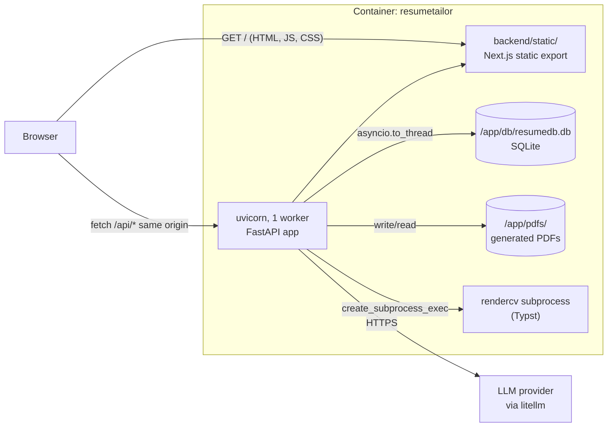
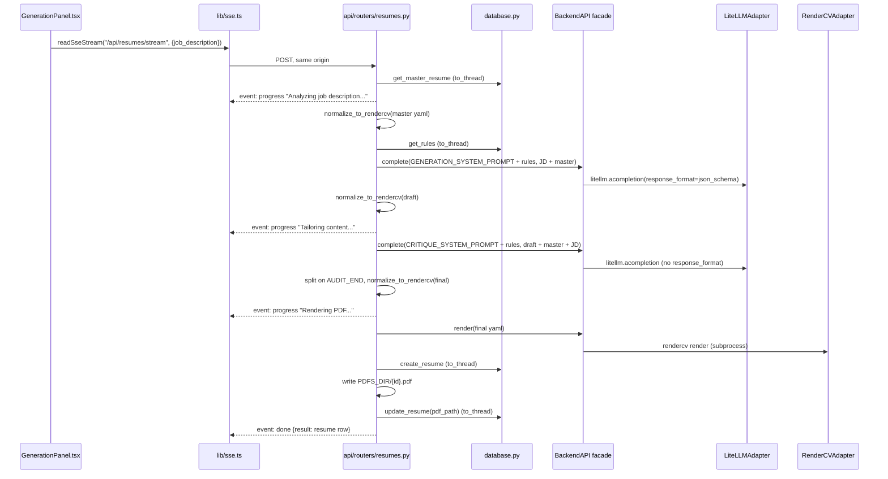
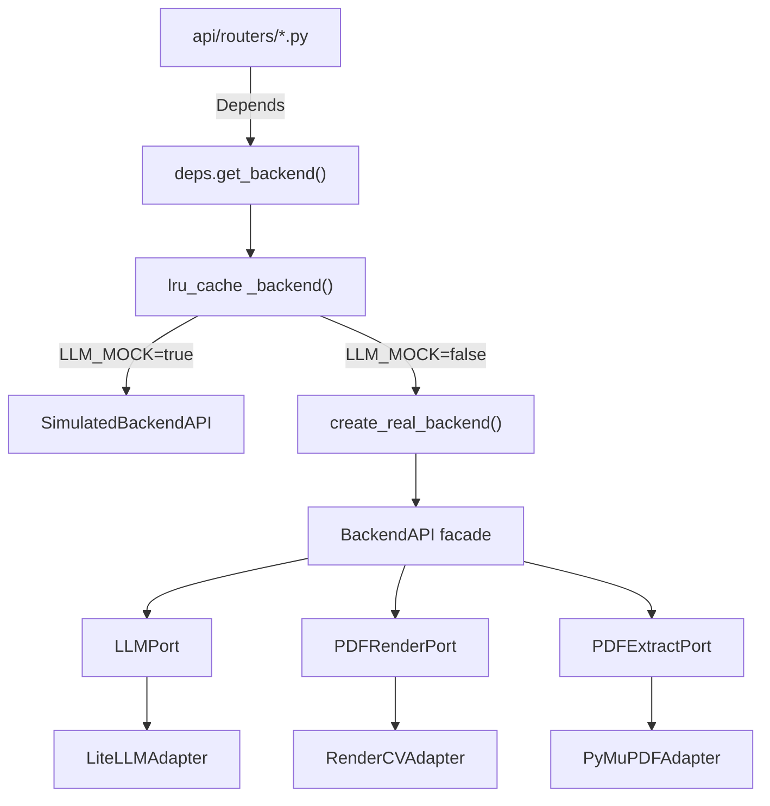
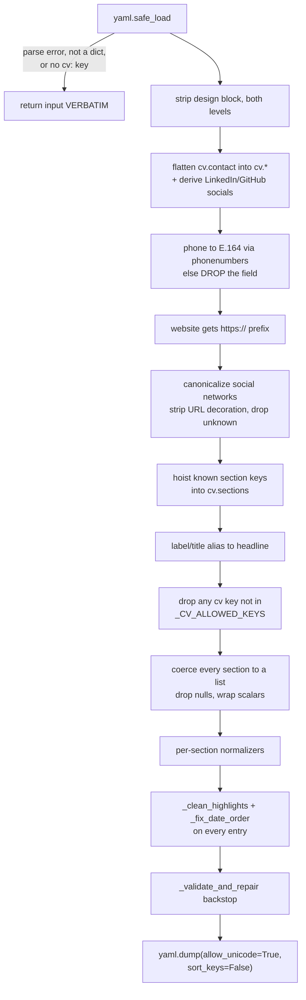
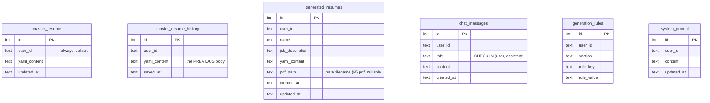

# Architecture

How ResumeTailor works **today**. Every claim here is checkable against the code at the path
given, or against one of the audit reports in [`reports/`](./reports/).

This document describes the system as it stands early in the restructure: wave 0 is complete and
wave 1 is in flight. The target architecture is [`PLAN.md`](../PLAN.md) §3, and the two still
differ in significant ways. Wherever they differ, this document says so in a block like the one
below, and the rest of the text describes the present.

> **Target, not built yet.** A statement in this form describes something `PLAN.md` commits
> to building. It does not exist in the code. Do not write against it.

**Related documents:** [`API.md`](./API.md) (every endpoint and its real response shape),
[`DEPLOYMENT.md`](./DEPLOYMENT.md) (how to run it), [`TROUBLESHOOTING.md`](./TROUBLESHOOTING.md)
(what goes wrong), [`adr/`](./adr/) (why the load-bearing choices were made),
[`../CONTRIBUTING.md`](../CONTRIBUTING.md) (how to change it).

---

## 1. Shape of the system

One container. One process. One SQLite file.



The frontend is a **static export** (`frontend/next.config.js`: `output: 'export'`,
`distDir: 'out'`). It is built at image-build time and copied into `backend/static/`, which
FastAPI mounts at `/` with `html=True` (the end of `create_app` in
`backend/src/resumetailor/main.py`). The mount is registered **last**, after every router, so it
does not shadow `/api/*` or `/docs`. It is skipped entirely in a source checkout that has never
built the frontend.

Because the UI and the API are served from the same origin, the API client uses relative paths
(`frontend/src/lib/api.ts`) and there is no CORS middleware anywhere. That is correct today and
is a real constraint: moving the frontend to a separate origin breaks every call at once.

The one thing that is deliberately *not* in the container: a TeX distribution. See §7.

---

## 2. Where the code lives

| Path | What it holds |
|---|---|
| `backend/src/resumetailor/main.py` | `create_app()`, the lifespan, and the assembly order: logging, middleware, error handlers, routers, static mount |
| `backend/src/resumetailor/core/config.py` | `Settings` (pydantic-settings) behind an `lru_cache`d `get_settings()`, plus `validate_startup_settings` and the resolved path constants |
| `backend/src/resumetailor/core/errors.py` | The `BackendError` hierarchy, each class carrying its own status code and machine code, and the one function that registers them as HTTP handlers |
| `backend/src/resumetailor/core/logging.py` | `configure_logging`, a JSON formatter, and the `request_id` contextvar |
| `backend/src/resumetailor/core/middleware.py` | `RequestContextMiddleware`: assigns or reuses a request id and echoes it as `X-Request-ID` |
| `backend/src/resumetailor/deps.py` | The entire DI container: one `lru_cache`d factory that branches on `LLM_MOCK` |
| `backend/src/resumetailor/ports.py` | Three `Protocol`s. It now re-exports the error taxonomy from `core/errors.py` so the adapters keep importing from where they always did |
| `backend/src/resumetailor/adapters.py` | `LiteLLMAdapter`, `RenderCVAdapter`, `PyMuPDFAdapter` |
| `backend/src/resumetailor/backend_api.py` | `BackendAPI`, a facade fusing all three ports, plus the composition root |
| `backend/src/resumetailor/simulator.py` | `SimulatedBackendAPI`, the deterministic stand-in used when `LLM_MOCK=true` |
| `backend/src/resumetailor/api/routers/*.py` | Seven route modules. Business logic lives here too (see §4) |
| `backend/src/resumetailor/database.py` | 17 free functions over raw `sqlite3`, plus `DEFAULT_RULES` and `DEFAULT_SYSTEM_PROMPT` |
| `backend/src/resumetailor/yaml_utils.py` | `normalize_to_rendercv` and the validation backstop (see §6) |
| `backend/src/resumetailor/prompts.py` | The generation and critique system prompts, and `rules_block()` |
| `backend/db/schema.sql` | The whole schema, as `CREATE TABLE IF NOT EXISTS` (see §9) |
| `backend/rendercv_config/` | `design.yaml` and `locale.yaml`, threaded into the renderer. `settings.yaml` is dead |
| `frontend/src/components/` | Flat component folder. `WorkstationShell.tsx` is the root. Still where every feature component lives |
| `frontend/src/design-system/` | Primitives from task 1.4. New UI builds against these, not against `components/ui/` |
| `frontend/src/lib/` | `api.ts` (typed client), `sse.ts` (stream reader), `types.ts` (hand-written types) |
| `test/e2e/` | Playwright specs. Run them only through `scripts/run_e2e.sh` (see `DEPLOYMENT.md` §7) |

### The old-to-new path mapping

Task 1.1 relocated `backend/app/` to `backend/src/resumetailor/`, so the paths above are the
current ones. **The six audit reports in [`reports/`](./reports/) all cite the old paths**, with
line numbers against commit `e943dfb`, and they are deliberately left that way: they are evidence,
and evidence has to stay reproducible against the commit it was gathered on. `PLAN.md` §2.1
carries the same caveat and points here. This table is the bridge.

| Was | Is now |
|---|---|
| `backend/app/main.py` | `backend/src/resumetailor/main.py` |
| `backend/app/config.py` | `backend/src/resumetailor/core/config.py` |
| `backend/app/routes/*.py` | `backend/src/resumetailor/api/routers/*.py` |
| everything else directly under `backend/app/` (`adapters`, `backend_api`, `database`, `deps`, `ports`, `prompts`, `simulator`, `yaml_utils`) | same filename directly under `backend/src/resumetailor/` |
| import path `app.*`, for example `from app.database import ...` | `resumetailor.*`, and absolute rather than relative |
| uvicorn target `app.main:app` | `resumetailor.main:app`, with `src/` on `PYTHONPATH` |
| `--cov=app`, `mypy app` | `--cov=resumetailor`, `mypy` against `files = ["src/resumetailor"]` |

Unchanged by the move, despite appearing alongside the paths above in the audits:
`backend/tests/`, `backend/db/schema.sql`, `backend/rendercv_config/`, `backend/pyproject.toml`,
`test/` and everything under `frontend/`.

Findings in the audits are still accurate. Only the locations moved, plus the handful of things
task 1.1 actually fixed, which this document marks where they occur (logging and request ids in
§6, the error hierarchy in §4.1, startup validation in
[`DEPLOYMENT.md`](./DEPLOYMENT.md) §2).

> **Target, not built yet.** `PLAN.md` §3.2 goes further than the move: the top-level modules
> listed above (`adapters.py`, `database.py`, `yaml_utils.py`, `prompts.py`, `backend_api.py`)
> split into the `domain/`, `db/`, `llm/`, `pdf/`, `rendering/` and `resume_schema/` packages.
> Those package directories exist as empty scaffolding; the code has not moved into them.
> Tasks 1.2, 1.3 and 2.5 do that. On the frontend, task 1.4 has added
> `frontend/src/design-system/` and populated it with primitives, but nothing has moved out of
> `frontend/src/components/` yet and `frontend/src/features/` does not exist.

---

## 3. The request path, end to end

Take the most involved request in the app, `POST /api/resumes/stream`.



Three conventions are visible in that path and hold everywhere in the backend:

1. **Every synchronous SQLite call is wrapped in `asyncio.to_thread`.** This is done
   consistently, at every call site in every route module. It is the one piece of async
   discipline the codebase gets right without exception.
2. **The `db_path` is threaded as a string argument**, resolved by a module-local `_db_path()`
   helper that reads the cached `Settings`. Five route modules carry an identical copy of that
   helper. There is no repository, no `Depends(get_db)`, no database port.
3. **The LLM, the renderer and the PDF extractor go through `Depends(get_backend)`.** That is
   the clean half of the architecture, and §4 is about exactly where it stops.

Two things in that diagram are worth flagging as defects rather than design:

- `normalize_to_rendercv` runs **on the event loop**, not in a thread. It performs a full
  RenderCV pydantic model build. Measured at 4.94s cold and 0.13s warm
  (`reports/audit-data-pipeline.md` P1 #4). With one uvicorn worker the first render after boot
  freezes the entire server, health checks included. Registered as D-05.
- The PDF write at `PDFS_DIR/{id}.pdf` is a blocking filesystem write inside an async generator,
  and the row is committed before the file exists. A crash between the two leaves an orphan
  either way, and nothing reaps them (D-20).

---

## 4. Ports and adapters, and exactly where the boundary leaks

The intended design is hexagonal. It is genuinely hexagonal **for the LLM, the renderer and the
PDF extractor**, and it is bypassed for everything else.

### 4.1 The clean half



`backend/src/resumetailor/ports.py` declares three `Protocol`s: `LLMPort`, `PDFRenderPort` and
`PDFExtractPort`. The error taxonomy that used to sit beside them now lives in
`core/errors.py` and is re-exported from `ports.py`, so existing call sites are unchanged. Four
of those exceptions are mapped to HTTP, and each carries its own status code and machine code as
class attributes: `LLMAuthError` (500), `LLMUnavailableError` (503), `RenderError` (500),
`PDFExtractError` (422). Anything that is not a `BackendError` is a bug and becomes a 500.

This boundary earns its keep: it is the reason a deterministic test mode exists at all. Flipping
`LLM_MOCK=true` swaps the whole backend object for `SimulatedBackendAPI`, so the test suite, the
e2e stack and CI all run with no network and no API key.

Two properties of that `lru_cache` are load-bearing and easy to trip over:

- The backend is a **process-wide singleton constructed lazily on the first request that needs
  it**, not at startup.
- Constructing `LiteLLMAdapter` has a global side effect: it writes the API key into
  `os.environ["OPENAI_API_KEY"]` from its constructor. That environment then gets inherited by
  the `rendercv` child process, which has no use for it (D-49).

Changing `LLM_MODEL` or `LLM_MOCK` at runtime is impossible without clearing that cache, and
nothing in production clears it. The test suite does, through an autouse fixture in
`backend/tests/conftest.py`.

### 4.2 Where it leaks

Four things bypass the boundary entirely, and all four are direct compile-time imports in the
route modules:

| Leak | Consequence |
|---|---|
| `database.py` is imported by name in every route module | No `DBPort`, no repository, no injection. Swapping persistence means rewriting all 17 functions and touching five route modules |
| `yaml_utils.normalize_to_rendercv` is imported directly | The normalizer cannot be substituted or bounded |
| Prompts live in five places | `prompts.py`, an inline constant in `api/routers/master_resume.py`, an inline constant in `api/routers/evaluate.py`, `DEFAULT_SYSTEM_PROMPT` in `database.py`, and a fifth divergent copy inline in `api/routers/chat.py` |
| `BackendAPI` fuses all three ports into one object | A route that only needs PDF rendering receives an object that can also call the LLM. No interface segregation |

And the business logic itself lives in the handlers. `generate_resume_stream` in
`backend/src/resumetailor/api/routers/resumes.py` is roughly 90 lines inside an HTTP handler containing the master
fetch, normalization, rules assembly, the two-pass LLM pipeline, the `AUDIT_END` protocol, PDF
rendering, filesystem persistence, two DB writes and the SSE framing. There is no service layer
and no domain object for a resume, which is why none of that orchestration can be unit tested
without an HTTP client.

Net layering as built:

```
api/routers/  --Depends--> deps.get_backend() --> BackendAPI --> ports --> adapters  (clean)
api/routers/  --import---> database.*                                               (leaky)
api/routers/  --import---> yaml_utils.normalize_to_rendercv                         (leaky)
api/routers/  --import---> prompts.* + inline prompt constants                      (leaky)
```

Full detail with line numbers: `reports/audit-backend.md` §1.

> **Target, not built yet.** `PLAN.md` §3.2 splits the facade into per-port dependencies,
> introduces repository protocols behind `db/repositories/`, and moves the handler bodies into
> `domain/tailoring.py` and `domain/evaluation.py`. Tasks 1.1, 1.2 and 2.5.

---

## 5. The two-pass tailoring pipeline

Generation is **generate, then audit**. Both passes are LLM calls; the second one grades and
rewrites the first.

**Pass 1, generate.** System prompt is `GENERATION_SYSTEM_PROMPT` (`backend/src/resumetailor/prompts.py`)
with the rules block appended. It is a five-step instruction set: extract from the JD, apply
per-section content rules, obey anti-hallucination absolutes, budget characters per bullet, and
apply ATS keyword strategy. The call uses a strict `json_schema` response format with a single
`yaml_content` string property, so pass 1 output is machine-parseable by construction.

**Pass 2, audit.** System prompt is `CRITIQUE_SYSTEM_PROMPT`, an audit rubric organized as
S1-S6 (structure), L1-L3 (length), H1-H3 (hallucination), A1-A3 (ATS) and K1-K2 (skills format).
The model is asked to emit its findings between `AUDIT_START` and `AUDIT_END` markers and then
the corrected YAML. This pass uses **no** response format. The route splits on the literal
`AUDIT_END` and takes everything after it.

That sentinel is the fragile part of the pipeline. If the model omits `AUDIT_END`, the fallback
is `.strip()` of the whole response, so the audit prose itself becomes the YAML. It is then
normalized (which fails to parse and returns the input verbatim, see §6) and **persisted** to
`generated_resumes.yaml_content` before `render` rejects it.

**Rules injection.** `rules_block()` formats the rows of `generation_rules` as
`- {section}.{rule_key} = {rule_value}` under a header saying they override any conflicting
counts above, and appends the block to **both** system prompts. This is the only dynamic element
of either prompt, and it is a user-writable path into the system prompt: `PUT /api/rules` takes
three bare strings with no validation. Combined with the absence of authentication (§10), any
caller who can reach the port can inject arbitrary text into the generation and critique prompts.

The same `complete()` call is used for two other flows, each with its own inline JSON schema:
PDF import (`api/routers/master_resume.py`) and evaluation (`api/routers/evaluate.py`). The import and
generation schemas are byte-identical apart from the schema `name`.

**One model serves all four workloads.** `LLM_MODEL` (default `gpt-4o-mini`) is used for chat,
both generation passes, evaluation and PDF import. There is no per-task override, despite the
critique pass being a materially harder reasoning task than chat.

**There is no timeout, no retry, no backoff and no `max_tokens` on any LLM call** (D-46). A
rate limit becomes an immediate client-visible 503. Token usage is never read, so spend is
unmeasured.

---

## 6. The YAML normalize-and-repair chain

`normalize_to_rendercv` (`backend/src/resumetailor/yaml_utils.py`) is the single translation layer between
non-deterministic LLM output and RenderCV's pydantic schema. It is the highest-risk file in the
repository and the one with the most hard-won logic. `PLAN.md` §2 is explicit that it moves but
does not get rewritten.

It runs on **every** write path that reaches the renderer: master-resume preview, PDF import,
and all three normalization points in generation.



Things worth knowing before you touch it:

- **The silent passthrough is real.** On a YAML parse failure, on a non-dict document, or on a
  missing or non-dict `cv:` key, the function returns its input **unchanged**. Malformed input
  flows onward as if it had been normalized.
- **`_SECTION_KEYS` hoists twelve keys** into `cv.sections`, but only five of them have
  normalizers dispatched by name: `experience`, `education`, `projects`, `skills`,
  `certifications`. `work_experience` is hoisted and never normalized, so it reaches RenderCV
  untyped (D-24). `extra_curricular_activities` is in the same position.
- **The backstop prunes rather than reports.** `_validate_and_repair` builds the real RenderCV
  pydantic model and iteratively deletes whatever fails validation, up to five rounds, sorting
  error locations deepest-first so that deleting `experience[1]` never shifts a pending index
  for `experience[0]`. An invalid email is deleted and the user gets a PDF with no email address
  and no warning. `normalize_to_rendercv` returns a bare `str`, so there is no channel for
  diagnostics at all (D-08). The same applies to dropped phone numbers and dropped social
  networks.
- **The backstop fails open.** It imports RenderCV private internals
  (`rendercv.exception`, `rendercv.schema.rendercv_model_builder`) inside a bare
  `except Exception: return`. A RenderCV reorganization turns the whole backstop into a
  permanent silent no-op with no log line, and the test guarding it uses `importorskip` so it
  would merely skip (D-17). `pyproject.toml` pins `rendercv[full]>=2.8` with no upper bound.
- **The backstop validates the wrong theme.** It probes with `design: {theme: classic}` while
  the renderer actually passes `--design` pointing at `design.yaml`, whose theme is
  `engineeringresumes` (D-18).
- **`phonenumbers` is imported but declared nowhere.** It arrives transitively through
  `rendercv[full]` (D-19).

Those warnings now go somewhere. `configure_logging` is called first thing in `create_app`, so
the module logger in `yaml_utils.py` reaches a real handler and its per-field prune messages
appear in the log (D-52, closed by task 1.1). They still do not reach the **user**, which is the
part D-08 is about and which task 1.3 closes.

> **Target, not built yet.** `PLAN.md` §3.2 splits this file into `resume_schema/` with
> `normalize.py` returning a `NormalizeResult(yaml, dropped[])` so pruned fields reach the UI,
> `repair.py` importing RenderCV internals once at startup so an ImportError fails the boot
> rather than degrading silently, and `prompt.py` generating the LLM-facing schema text from
> the models so the contract stops existing in five drifting copies. Task 1.3.

---

## 7. The renderer, and why there is no TeX Live

`RenderCVAdapter.render` writes the YAML to a fresh `tempfile.TemporaryDirectory()` and spawns:

```
rendercv render <tmp>/resume.yaml
  --design  backend/rendercv_config/design.yaml
  --pdf-path <tmp>/resume.pdf
  --dont-generate-markdown --dont-generate-html --dont-generate-png
```

It is `asyncio.create_subprocess_exec` with an argv **list**, not a shell string, so there is no
shell injection surface.

**RenderCV 2.x compiles with Typst, not LaTeX.** `rendercv[full]` ships the Typst compiler as a
pip wheel, which is why the Dockerfile has no `apt-get` layer at all and no `texlive` anywhere.
A naive "just add texlive-full" would add roughly 4 GB to a ~430 MB image. This was learned the
hard way (commit `c6c20da`). Do not regress it. Evidence and image-size accounting:
`reports/audit-infra.md` §1.

**Concurrency is safe by accident.** RenderCV's default output folder resolves relative to the
*input file*, not the working directory, and each render gets its own temporary directory, so
two simultaneous renders cannot collide on disk. Nothing in the code documents or tests that
invariant.

**Config threading, as actually done:**

| File | How it reaches RenderCV |
|---|---|
| `design.yaml` | Passed as `--design <abs path>`. The normalizer strips `design` from the document at both levels so the two cannot conflict |
| `locale.yaml` | **Not** passed as a flag. Its parsed contents are merged into the top level of the user's document, guarded by `if "locale" not in data` |
| `settings.yaml` | Not threaded in at all. Dead file. It also hardcodes a specific person's name into repo config (D-15) |

The locale merge rests on a misdiagnosis recorded in the code comment: the real RenderCV flag is
`--locale-catalog / -lc` and it does take a path. `--locale` does not exist. The workaround
works but `data.update(locale_data)` splices **every** top-level key of `locale.yaml` into the
CV document, and a stray `locale:` key emitted by the LLM silently disables the project locale.
A test asserts `"--locale" not in cmd_str`, which freezes the misdiagnosis in place (D-16).

**There is no timeout and no concurrency cap on the subprocess** (D-07). A hung Typst compile
holds the SSE connection, the temporary directory and the process forever. N concurrent
generations spawn N Typst processes. Full subprocess stdout and stderr, including absolute paths
and tracebacks, is returned verbatim to the client in the error body (D-53).

---

## 8. SSE transport and its event vocabulary

Three routes stream. All three use Server-Sent Events over a `POST` body, which is why the
client cannot use `EventSource` and hand-rolls a reader in `frontend/src/lib/sse.ts`.

Wire format is `event: <name>\ndata: <json>\n\n`, produced by a `_sse` helper that is
**triplicated verbatim** across the three route modules.

| Route | `progress` | `token` | `done` payload | `error` codes |
|---|---|---|---|---|
| `POST /api/chat/stream` | none | `{delta}` | `{result: {text, action: null}}` | `LLM_AUTH_ERROR`, `LLM_UNAVAILABLE`, `CHAT_FAILED` |
| `POST /api/resumes/stream` | 3 fixed messages | none | `{result: <generated_resumes row>}` | `NO_MASTER_RESUME`, `LLM_AUTH_ERROR`, `LLM_UNAVAILABLE`, `RENDER_FAILED`, `PDF_EXTRACT_FAILED`, `GENERATION_FAILED` |
| `POST /api/evaluate/stream` | 1 message | none | `{result: {match_score, critique, matched_keywords, missing_keywords}}` | `LLM_AUTH_ERROR`, `LLM_UNAVAILABLE`, `EVALUATION_FAILED` |

Only chat genuinely streams. Generate and evaluate emit canned `progress` frames around a
blocking `complete()` call, so the progress indicator has no relationship to actual progress.
Generation emits "Rendering PDF..." *before* the render begins and nothing during it.

`done` on chat always carries `"action": null`. There is no tool calling anywhere in the
backend, so the `ChatAction` type in `frontend/src/lib/types.ts` and the whole
`master_resume_updated` branch in `ChatPanel.tsx` are dead wiring (D-33).

Two transport-level facts to know before you debug a stream:

- **Every SSE failure is HTTP 200.** All three routes wrap their entire body in a try/except
  *inside* the generator, so the response status is committed before anything can fail and the
  global exception handlers in `main.py` are dead code for these routes. Uptime checks see 100%
  success during a total LLM outage (D-55).
- **Only `Cache-Control: no-cache` is set.** There is no `X-Accel-Buffering: no`, no
  `Connection: keep-alive` and no keepalive comment frames, so an idle proxy will cut a long
  two-pass generation.

On the client side, `sse.ts` accepts an `AbortSignal` but **no `AbortController` exists anywhere
in the codebase** (D-40). Closing the chat drawer or navigating mid-generation orphans the
connection and the server-side job.

---

## 9. The data model

Raw `sqlite3`, no ORM. Six tables, defined once in `backend/db/schema.sql` and re-asserted on
every boot by `init_db` via `executescript`.



There are **no foreign keys, no indexes and no relationships declared in the schema**. The
diagram above shows the tables, not constraints that exist. `user_id` is the only thing
connecting them and it is free-floating TEXT.

Behaviour you cannot read off the schema:

- **`master_resume` and `system_prompt` are one row per user by convention only.** Neither has
  `UNIQUE(user_id)`, and both upserts are read-then-write. Two concurrent `PUT`s on a fresh
  database both see no row and both insert; reads then return whichever row SQLite yields
  first, so edits appear to revert at random (D-06). `generation_rules` got this right with
  `UNIQUE(user_id, section, rule_key)` and a real `ON CONFLICT` upsert.
- **`master_resume_history` is write-only.** Every save inserts the *previous* body and prunes
  to the newest 10 (`HISTORY_LIMIT`). Nothing ever reads it: there is no history endpoint and no
  restore path. `delete_master_resume` leaves its history rows orphaned forever.
- **`pdf_path` stores a bare filename**, always `{resume_id}.pdf`, resolved against `PDFS_DIR`
  at read time with a plain `Path` join and no containment check. Not exploitable today because
  the update schema omits the field, but `update_resume` does accept a `pdf_path` kwarg (D-25).
- **`generation_rules` holds `(section, rule_key, rule_value)` triples**, seeded from
  `DEFAULT_RULES` in `database.py` on first boot. Values are strings, never parsed, interpolated
  into the prompt verbatim. Two of the seeded sections (`extracurricular`) do not match the YAML
  section key (`extra_curricular_activities`), so those rules name a section that does not exist
  in the document the LLM is editing (D-23).
- **`system_prompt.content` is used by the chat path only.** Generation and evaluation use the
  hardcoded constants in `prompts.py` and `api/routers/evaluate.py`.
- **Timestamps are UTC-naive and space-separated** (`datetime('now')` produces
  `2026-09-18 14:22:01`). `new Date(...)` in the browser parses that as *local* time, so every
  displayed time is wrong by the host's UTC offset (D-09).
- **Connections are never closed.** `with sqlite3.connect(...)` is a *transaction* context
  manager in the stdlib, not a closing one. All 17 functions leak the connection to the garbage
  collector (D-13).
- **No WAL, no `busy_timeout` tuning, no `foreign_keys` pragma.** Two concurrent generations
  raise `database is locked`, which surfaces to the user as a generic `GENERATION_FAILED`
  (D-56). See [`TROUBLESHOOTING.md`](./TROUBLESHOOTING.md) §1.

**There is no migration mechanism.** `init_db` runs `CREATE TABLE IF NOT EXISTS` on every boot,
so adding a column to `schema.sql` is a **silent no-op against any existing volume**. The next
query raises `no such column`. This is the single most dangerous latent issue in the project
(D-02).

> **Target, not built yet.** Numbered SQL migrations with a `schema_version` table, applied in
> order at startup, plus `UNIQUE(user_id)`, indexes, foreign keys with `ON DELETE CASCADE`, WAL,
> `busy_timeout`, ISO-8601 timestamps, real connection closing, and backup and restore scripts.
> Task 1.2. The mechanism choice is [ADR 0002](./adr/0002-numbered-sql-migrations.md).

---

## 10. The single-user assumption

`DEFAULT_USER_ID = "default"` in `backend/src/resumetailor/database.py` is the default argument of all 17
database functions. **No route ever passes a `user_id`.** There is no session, cookie, header,
token or `Depends(get_current_user)` anywhere in the backend.

The split matters:

- **The data layer is genuinely parameterized.** Every function takes `user_id` and filters on
  it, including the history insert, the history prune, the pagination count and the seeding.
  Every table declares `user_id TEXT NOT NULL DEFAULT 'default'`. Multi-tenancy at the data
  layer is one threaded parameter away.
- **The transport layer has no concept of identity at all.** That is correct for the stated
  scope and is not a bug to be fixed in passing.
- **The filesystem layout is not forward-compatible.** PDFs are written flat as
  `{PDFS_DIR}/{resume_id}.pdf` with no `user_id` in the path. Unlike the schema, this *would*
  require migration.

`user_id` also leaks into the client as a vestigial field on four TypeScript interfaces, and
`ChatPanel.tsx` hardcodes `user_id: "default"` when building optimistic messages. Harmless, but
it is client-side state that means nothing.

**There is no authentication or authorization on any endpoint.** Anyone who can reach the port
can read the owner's full PII, overwrite the master resume, rewrite the system prompt used for
every future chat turn, and spend the owner's LLM credits without limit. That is tolerable on
loopback and nowhere else. The interim answer, and the reason it is an interim answer rather
than a fix, is [ADR 0004](./adr/0004-no-auth-loopback-only.md). The operational consequence is
in [`DEPLOYMENT.md`](./DEPLOYMENT.md) §6.

---

## 11. The frontend model

One route. `frontend/src/app/page.tsx` renders `WorkstationShell`, and that is the whole
routing story: there is no Next router usage, no URL state, and no deep links.

`WorkstationShell.tsx` holds all shared state in `useState`:

- `masterResume`, loaded once on mount through `api.getMasterResume()`
- `view`, a `View` union of `"editor" | "generate" | "resumes" | "evaluate"`, switched by the
  sidebar and used to conditionally render exactly one panel
- `selectedResume`, `chatOpen`, `loading`, `loadError`

Three screens are mutually exclusive at the top: a loading splash, a retryable error screen
(added by task 0.2), and the onboarding `EmptyState` when there is genuinely no master resume.
Only then does the workspace render.

The panels are conditionally rendered, which is the mechanism behind the worst frontend defect:
**clicking any nav item unmounts the editor and discards its unsaved YAML buffer**, because the
buffer lives in `MasterResumePanel`'s local state with no dirty guard and no draft persistence
(D-30). The header shows "edited" right up to the moment the work is thrown away.

Related, and worth knowing before you reason about what gets generated: **Generate and Evaluate
use the last *saved* resume, not what is on screen.** Evaluate sends the shell's copy; Generate
discards its prop entirely and the backend re-reads the database (D-41).

The API client (`lib/api.ts`) is hand-written against hand-written types in `lib/types.ts`.
There is no runtime validation of any response, and the backend declares no `response_model`
anywhere, so those types are unenforced on both ends (D-54, D-60). The client does now return
early on 204 and empty bodies, and surfaces both `detail` and `error` plus a machine-readable
`code` on an exported `ApiError` (tasks 0.1 and 0.2).

Theme is hardcoded dark: `layout.tsx` sets `className="dark"` unconditionally and `next-themes`
is installed and unused (D-11). There is not one Tailwind breakpoint prefix in any component,
and three fixed columns total 876px of chrome before content, so the layout breaks outright
below about 900px (D-43).

> **Target, partly built.** The Letterpress design system
> ([`design/DESIGN-SYSTEM.md`](./design/DESIGN-SYSTEM.md), binding as of decision D1) has its
> primitives in `frontend/src/design-system/` as of task 1.4. Everything described above is still
> the shipped behaviour: the components in `frontend/src/components/` have not been rebuilt against
> those primitives. Still to come: a light-first theme with a real toggle, `features/*` folders,
> TanStack Query for server state, zod-validated responses against generated types, and responsive
> breakpoints down to tablet. Tasks 2.2, 2.3, 3.1 and 3.2.

---

## 12. Deterministic mode

`LLM_MOCK=true` swaps `BackendAPI` for `SimulatedBackendAPI` wholesale. It returns fixed strings
for `complete` and `stream`, a fixture PDF for `render`, and canned resume text for `extract`.

One property of it is a genuine trap: **its dispatch branches on substring matches against the
system prompt text.** It looks for `"ResumeTailor"`, `"ResumeAuditor"` and `"evaluation"`. Those
substrings are load-bearing couplings to `prompts.py` and `api/routers/evaluate.py`. Reword a prompt
header and the simulator silently falls through to a different branch, and mock e2e runs start
returning wrong-shaped data with no test failure at the seam.

It also reads its fixture PDF from `backend/tests/fixtures/mock.pdf`, which is production code
reaching into the test tree.
